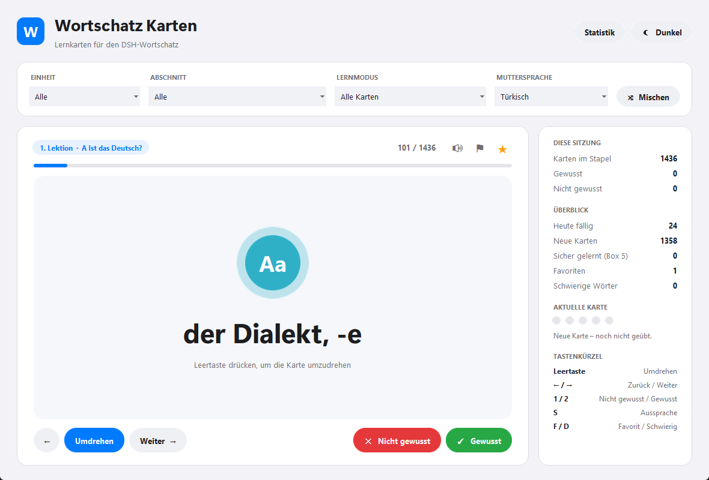
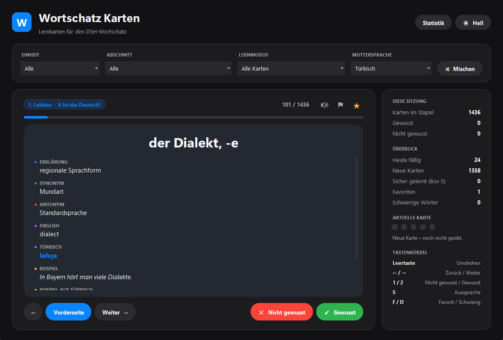
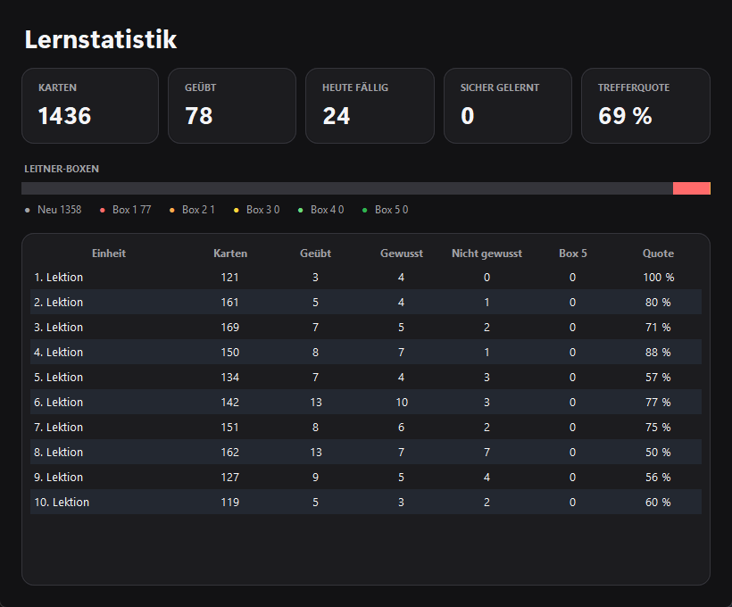

<p align="center">
  
</p>

<h1 align="center">Wortschatz Karten</h1>

<p align="center">
  Flashcards for the German DSH vocabulary, built for Windows.<br>
  Learn every word at the right time with spaced repetition.
</p>

<p align="center">
  <a href="https://github.com/smyrna-pergamum/wortschatz-karten/releases/latest"></a>
  <a href="LICENSE"></a>
  
  <a href="https://github.com/smyrna-pergamum/wortschatz-karten/releases"></a>
</p>

<p align="center">
  <a href="https://github.com/smyrna-pergamum/wortschatz-karten/releases/latest"><b>⬇ Download for Windows</b></a>
  &nbsp;·&nbsp; <a href="#features">Features</a>
  &nbsp;·&nbsp; <a href="#quick-start">Quick start</a>
  &nbsp;·&nbsp; <a href="#privacy">Privacy</a>
</p>



Wortschatz Karten is a free, open-source flashcard app for German learners preparing for the DSH or working at C1 level. It comes with 1,436 words in 10 units, shows explanations, synonyms, antonyms and example sentences on the back of each card, and uses the Leitner system to bring every word back just before you would forget it. Your vocabulary and your progress stay on your computer.

## Features

- **Spaced repetition:** the Leitner system with 5 boxes. Known cards return after 1, 2, 4, 8 and 16 days; unknown cards come back at the end of the round.
- **Learning modes:** review (due + new), all cards, new only, last answered wrong, favorites and difficult words, filtered by unit and section.
- **Rich card backs:** explanation, synonyms, antonyms, English, Turkish and an example sentence, colour-coded.
- **Your mother language:** the word and the example sentence are translated into Turkish, English, Arabic, Russian, Persian, Spanish, French, Italian, Polish or Ukrainian, and cached.
- **Pronunciation:** hear every German word, online with a local audio cache or offline with a German Windows voice.
- **Favorites and difficult words**, exportable to Excel.
- **Statistics:** Leitner box distribution, hit rate and results per unit.
- **Your own word lists:** import any Excel file; progress is kept when you update it.
- **Comfortable to use:** light and dark theme, card-flip animation, keyboard shortcuts, and a layout that fits small laptop screens and 125 % / 150 % display scaling.



## Quick start

1. Download `WortschatzKarten_Setup.exe` from the [latest release](https://github.com/smyrna-pergamum/wortschatz-karten/releases/latest).
2. Run it. The installer installs to `Program Files` (administrator rights required) and adds a Start menu entry, an optional desktop shortcut and an uninstaller.
3. Start **Wortschatz Karten**. On the first start it finds the included word list and asks whether to import it. Click **Yes** and press **Space** to flip the first card.

> **Unsigned build:** the installer is not code-signed yet, so Windows SmartScreen may warn about an unknown publisher (**More info → Run anyway**). You can check the download against the SHA-256 checksum in the release notes.

**Requirements:** Windows 10 or 11, x64.

### Keyboard shortcuts

| Key | Action |
| --- | --- |
| Space | Flip card |
| → / Enter | Next card |
| ← | Previous card |
| 1 / 2 | Not known / Known |
| S | Pronunciation |
| F / D | Toggle favorite / difficult |
| M | Shuffle |
| Ctrl+O | Update the Excel file |
| Ctrl+E | Export favorites and difficult words |

## Privacy

- No account and no telemetry. Your word list, progress and settings are stored in `%APPDATA%\WortschatzKarten\` and never uploaded.
- The internet is used for two optional things only: the **translation** sends the German word and the example sentence to Google Translate (example sentences fall back to MyMemory), and the **pronunciation** sends the German word to Google's text-to-speech service. Results are cached, so each text is requested only once.
- Everything else works offline. **Daten → Lernfortschritt zurücksetzen** deletes your progress.

## Feedback and contributing

Bug reports, ideas and pull requests are welcome in [Issues](https://github.com/smyrna-pergamum/wortschatz-karten/issues). To build from source, see [Build](#build).

---

# Technical documentation

**Language:** the interface is in German, the language being learned. Translations of the vocabulary are available in ten languages (see [Features](#features)).

## Running from source

Requires Python 3.10 or newer.

```bash
pip install -r requirements.txt
python wortschatz_karten.py
```

`openpyxl` is required. `deep-translator` (translation), `gTTS` (pronunciation) and `Pillow` (antialiased rounded shapes) are optional: without them the app still runs and says which feature is unavailable.

## Build

Requirements: Python 3.10+, [PyInstaller](https://pyinstaller.org) and [Inno Setup 6](https://jrsoftware.org/isinfo.php).

```bash
pip install -r requirements.txt pyinstaller
pyinstaller --noconsole --onedir --name WortschatzKarten --icon "Wortschatz_karten.ico" wortschatz_karten.py
ISCC.exe installer.iss
```

The installer is written to `installer_output\WortschatzKarten_Setup.exe`. It contains the app, `DSH_Wortschatz_Table.xlsx` and the icon. Keep the `AppId` in `installer.iss` constant so that new versions upgrade the existing installation.

## Vocabulary file (Excel)

**Daten → Excel aktualisieren…** imports an `.xlsx` file. The first 15 rows of each sheet are searched for a header row; German, English and Turkish column names are recognised. A sheet named `Tüm Kelimeler` / `Alle Wörter` / `All words` is preferred, and `Özet` / `Summary` sheets are skipped.

| Column | Meaning | Required |
| --- | --- | --- |
| `Unite` / `Lektion` | Unit | no (taken from the sheet name) |
| `Abschnitt` | Section / topic | no |
| `Deutsche Word` / `Wort` | German word | **yes** |
| `Erklärung` | German explanation | no |
| `Synonym` / `Antonym` | Synonyms / antonyms | no |
| `English` | English meaning | no |
| `Turkish` / `Muttersprache` | Turkish meaning | no |
| `Beispiel` | German example sentence | no |

On re-import, progress is matched by unit and word, so it survives edits, reordering and new rows. [`DSH_Wortschatz_Table.xlsx`](DSH_Wortschatz_Table.xlsx) is the included list and can serve as a template.

## Learning system

| Box | Next review after a correct answer |
| --- | --- |
| 0 | new card |
| 1 | 1 day |
| 2 | 2 days |
| 3 | 4 days |
| 4 | 8 days |
| 5 | 16 days (counted as learned) |

A wrong answer moves the card back to box 1, makes it due today and puts it at the end of the current round.



## Architecture

Everything is in `wortschatz_karten.py`.

| Part | Responsibility |
| --- | --- |
| `Store` | SQLite storage (words, progress, settings, translation cache), transactional import, schema migration from 1.0 |
| `read_excel_words`, `find_header` | Excel parsing with header detection and column aliases |
| `Speaker` | Pronunciation: audio cache → gTTS → German SAPI voice, played through the Windows MCI API |
| `ShapeRenderer`, `RoundButton`, `RoundedPanel` | Antialiased rounded UI elements on Tk canvases, card-flip animation |
| `WortschatzApp` | Window, deck logic, themes, responsive layout, statistics and export |

Network calls run in background threads; their results are passed to the Tk main thread through a queue.

## 1.1.0 — Bug fixes and new interface

| Area | Fix |
| --- | --- |
| Import | The Excel file stayed locked while the app was running. |
| Import | Updating the Excel file deleted all learning progress. The import is now a single transaction and keeps progress. |
| Import | `İ` in column headers was not normalized; `Lektion` and `MutterSprache` headers were not recognised; `Teil` was mapped to two columns. |
| Statistics | Units were sorted 1, 10, 2, … |
| Interface | The dark theme left labels, dropdown lists and the table light. |
| Interface | The window could be larger than the screen on small laptops and with 125 % / 150 % scaling, pushing the buttons out of view. |
| Translation | Results were written to the interface from a background thread. Errors always said "no internet", even when the service was rate-limited. |

New in 1.1.0: spaced repetition and learning modes, pronunciation, favorites and difficult words with Excel export, the statistics window, keyboard shortcuts, the redesigned interface and the responsive layout. Databases from 1.0 are migrated automatically.

## Components and licenses

| Component | Role | License |
| --- | --- | --- |
| Python / Tcl/Tk | Runtime and interface | PSF / Tcl license |
| openpyxl | Excel import and export | MIT |
| deep-translator | Translation (Google Translate, MyMemory) | MIT |
| gTTS | Pronunciation | MIT |
| Pillow | Antialiased shapes | MIT-CMU |
| PyInstaller | Packaging | GPL-2.0-or-later with bootloader exception |
| Inno Setup | Installer | Inno Setup license |

## License

Wortschatz Karten is licensed under the [MIT License](LICENSE).
